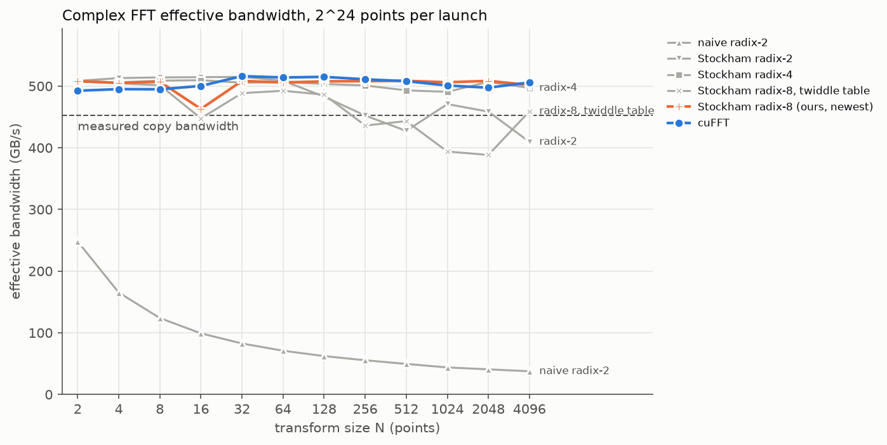
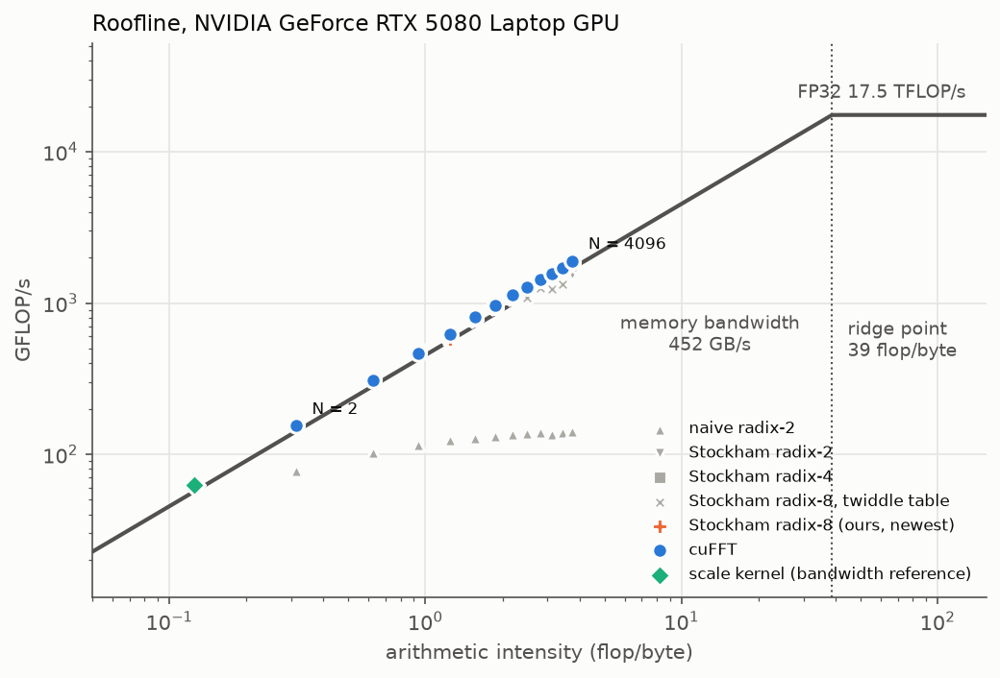
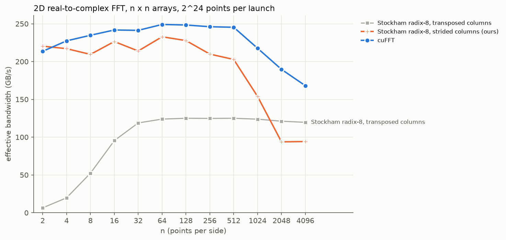
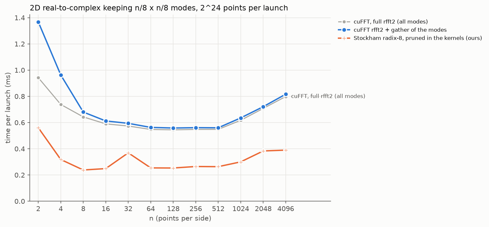

# gpu-spectral-stack

FFT kernels written from scratch in CUDA, a GPU pseudo-spectral physics solver built on them
that generates versioned training data, and a custom PyTorch spectral-convolution layer for a
Fourier Neural Operator.

Builds on [gpu-rf-pipeline](https://github.com/Jeanm2005/gpu-rf-pipeline), which provides the
radio signal-processing side. Status and plan: [docs/ROADMAP.md](docs/ROADMAP.md).

## What is here (Phase 1: FFT kernels)

Every implementation stays selectable by name, so each optimization is measured against the one
before it (`spectral.FFT_IMPLS`, `csrc/fft/registry.hpp`):

| Name | What it is |
|---|---|
| `naive` | radix-2 Cooley-Tukey: a bit-reversal pass, then one kernel launch per stage |
| `stockham_r2`, `stockham_r4` | Stockham in shared memory: one launch, data crosses global memory twice |
| `stockham_r8` | radix 8 with a final radix-2 or radix-4 stage (mixed radix 2/4/8) |
| `stockham_r8_table` | the same with twiddle factors read from a table instead of computed |

On top of them (`python/spectral/ops.py`):

- complex FFTs (`fft_c2c`) and real ones through the n/2-point complex trick (`rfft`,
  `irfft`), the combine step fused into the Stockham kernels' loads and stores
- 2D FFTs (`fft2`, `rfft2`, `irfft2`), with column transforms either strided in place or
  transposed (`columns="strided" | "transpose"`)
- pruned transforms for the FNO mode layout (`fft_truncated`, `ifft_from_modes`,
  `rfft2_truncated`, `irfft2_from_modes`): only the kept modes cross global memory

All of them are checked against float64 NumPy references with a tolerance that grows with
log2 N (`python/spectral/testing.py`).

## Results

Measured on an RTX 5080 Laptop GPU with the core clock locked; machine, conditions, and every
raw number are in [docs/results/](docs/results/README.md). Nsight Compute findings are in
[docs/PROFILING.md](docs/PROFILING.md).

<picture>
  <source media="(prefers-color-scheme: dark)" srcset="docs/figures/fft_bandwidth-dark.png">
  
</picture>

<picture>
  <source media="(prefers-color-scheme: dark)" srcset="docs/figures/roofline-dark.png">
  
</picture>

<picture>
  <source media="(prefers-color-scheme: dark)" srcset="docs/figures/fft2_columns-dark.png">
  
</picture>

<picture>
  <source media="(prefers-color-scheme: dark)" srcset="docs/figures/pruned-dark.png">
  
</picture>

### Against cuFFT

<!-- results:begin -->
Speed vs cuFFT is cuFFT's median time divided by ours: above 100 % we are faster. Each row processes 2^24 points (batch = 2^24 / points per transform) unless it says otherwise. Generated by `tools/results_table.py` from `docs/results/`.

#### Every complex 1D implementation, speed vs cuFFT

| n | naive | stockham_r2 | stockham_r4 | stockham_r8 | stockham_r8_table |
|---:|---:|---:|---:|---:|---:|
| 2 | 50 % | 103 % | 103 % | 103 % | 103 % |
| 4 | 33 % | 104 % | 102 % | 102 % | 102 % |
| 8 | 25 % | 104 % | 103 % | 102 % | 101 % |
| 16 | 20 % | 103 % | 102 % | 93 % | 89 % |
| 32 | 16 % | 100 % | 98 % | 98 % | 95 % |
| 64 | 14 % | 99 % | 99 % | 98 % | 96 % |
| 128 | 12 % | 94 % | 98 % | 99 % | 94 % |
| 256 | 11 % | 89 % | 98 % | 99 % | 85 % |
| 512 | 10 % | 84 % | 97 % | 100 % | 87 % |
| 1024 | 9 % | 94 % | 98 % | 101 % | 79 % |
| 2048 | 8 % | 92 % | 102 % | 102 % | 78 % |
| 4096 | 7 % | 81 % | 98 % | 99 % | 91 % |

#### 1D complex (C2C)

| n | cuFFT ms | fastest of ours | ms | speed vs cuFFT |
|---:|---:|---|---:|---:|
| 2 | 0.5451 | stockham_r2 | 0.5279 | 103 % |
| 4 | 0.5422 | stockham_r2 | 0.5233 | 104 % |
| 8 | 0.5425 | stockham_r2 | 0.5221 | 104 % |
| 16 | 0.5366 | stockham_r2 | 0.5218 | 103 % |
| 32 | 0.5200 | stockham_r2 | 0.5213 | 100 % |
| 64 | 0.5223 | stockham_r2 | 0.5276 | 99 % |
| 128 | 0.5212 | stockham_r8 | 0.5288 | 99 % |
| 256 | 0.5253 | stockham_r8 | 0.5284 | 99 % |
| 512 | 0.5284 | stockham_r8 | 0.5278 | 100 % |
| 1024 | 0.5358 | stockham_r8 | 0.5303 | 101 % |
| 2048 | 0.5397 | stockham_r8 | 0.5279 | 102 % |
| 4096 | 0.5305 | stockham_r8 | 0.5349 | 99 % |

#### 1D real to complex (R2C)

| n | cuFFT ms | fastest of ours | ms | speed vs cuFFT |
|---:|---:|---|---:|---:|
| 2 | 0.4010 | stockham_r2 | 0.3961 | 101 % |
| 4 | 0.3337 | stockham_r4 | 0.3345 | 100 % |
| 8 | 0.2999 | stockham_r2 | 0.2998 | 100 % |
| 16 | 0.2820 | stockham_r2 | 0.2812 | 100 % |
| 32 | 0.2923 | stockham_r2 | 0.2798 | 104 % |
| 64 | 0.2693 | stockham_r8 | 0.2767 | 97 % |
| 128 | 0.2668 | stockham_r8 | 0.2739 | 97 % |
| 256 | 0.2725 | stockham_r8 | 0.2738 | 100 % |
| 512 | 0.2731 | stockham_r8 | 0.2728 | 100 % |
| 1024 | 0.2698 | stockham_r8 | 0.2722 | 99 % |
| 2048 | 0.2693 | stockham_r8 | 0.2770 | 97 % |
| 4096 | 0.2712 | stockham_r4 | 0.2807 | 97 % |

#### 1D complex to real (C2R)

| n | cuFFT ms | fastest of ours | ms | speed vs cuFFT |
|---:|---:|---|---:|---:|
| 2 | 0.4238 | stockham_r4 | 0.4294 | 99 % |
| 4 | 0.3474 | stockham_r8 | 0.3494 | 99 % |
| 8 | 0.3011 | stockham_r4 | 0.3022 | 100 % |
| 16 | 0.2827 | stockham_r4 | 0.2877 | 98 % |
| 32 | 0.2797 | stockham_r4 | 0.2784 | 100 % |
| 64 | 0.2699 | stockham_r4 | 0.2781 | 97 % |
| 128 | 0.2673 | stockham_r4 | 0.2741 | 98 % |
| 256 | 0.2729 | stockham_r8 | 0.2758 | 99 % |
| 512 | 0.2739 | stockham_r4 | 0.2798 | 98 % |
| 1024 | 0.2740 | stockham_r4 | 0.2767 | 99 % |
| 2048 | 0.2717 | stockham_r8 | 0.2877 | 94 % |
| 4096 | 0.2738 | stockham_r8 | 0.2974 | 92 % |

#### 2D complex, n x n

| n | cuFFT ms | fastest of ours | ms | speed vs cuFFT |
|---:|---:|---|---:|---:|
| 2 | 1.0863 | stockham_r8/strided | 1.0463 | 104 % |
| 4 | 1.0681 | stockham_r4/strided | 1.0560 | 101 % |
| 8 | 0.5365 | stockham_r4/strided | 1.0720 | 50 % |
| 16 | 0.5234 | stockham_r4/strided | 1.0558 | 50 % |
| 32 | 0.5200 | stockham_r4/strided | 1.0551 | 49 % |
| 64 | 0.5410 | stockham_r8/strided | 1.0673 | 51 % |
| 128 | 0.7400 | stockham_r8/strided | 1.1101 | 67 % |
| 256 | 1.0544 | stockham_r8/strided | 1.2289 | 86 % |
| 512 | 1.0642 | stockham_r8/strided | 1.2392 | 86 % |
| 1024 | 1.1258 | stockham_r8/strided | 1.5969 | 70 % |
| 2048 | 1.3279 | stockham_r8/transpose | 2.1949 | 60 % |
| 4096 | 1.6097 | stockham_r8/transpose | 2.1968 | 73 % |

#### 2D real to complex, n x n

| n | cuFFT ms | fastest of ours | ms | speed vs cuFFT |
|---:|---:|---|---:|---:|
| 2 | 0.9425 | stockham_r4/strided | 0.9127 | 103 % |
| 4 | 0.7379 | stockham_r2/strided | 0.7448 | 99 % |
| 8 | 0.6431 | stockham_r2/strided | 0.6788 | 95 % |
| 16 | 0.5899 | stockham_r8_table/strided | 0.6238 | 95 % |
| 32 | 0.5735 | stockham_r4/strided | 0.5889 | 97 % |
| 64 | 0.5472 | stockham_r4/strided | 0.5776 | 95 % |
| 128 | 0.5446 | stockham_r4/strided | 0.5878 | 93 % |
| 256 | 0.5475 | stockham_r8/strided | 0.6418 | 85 % |
| 512 | 0.5481 | stockham_r8/strided | 0.6631 | 83 % |
| 1024 | 0.6174 | stockham_r8/strided | 0.8733 | 71 % |
| 2048 | 0.7079 | stockham_r8/transpose | 1.1084 | 64 % |
| 4096 | 0.7984 | stockham_r8/transpose | 1.1225 | 71 % |

#### 2D complex to real, n x n

| n | cuFFT ms | fastest of ours | ms | speed vs cuFFT |
|---:|---:|---|---:|---:|
| 2 | 0.9613 | stockham_r8_table/strided | 0.9601 | 100 % |
| 4 | 0.7469 | stockham_r2/strided | 0.7712 | 97 % |
| 8 | 0.6827 | stockham_r4/strided | 0.6996 | 98 % |
| 16 | 0.6236 | stockham_r4/strided | 0.6172 | 101 % |
| 32 | 0.5550 | stockham_r4/strided | 0.5967 | 93 % |
| 64 | 0.5468 | stockham_r4/strided | 0.5685 | 96 % |
| 128 | 0.5462 | stockham_r4/strided | 0.5851 | 93 % |
| 256 | 0.5485 | stockham_r8/strided | 0.6387 | 86 % |
| 512 | 0.5442 | stockham_r8/strided | 0.6687 | 81 % |
| 1024 | 0.6169 | stockham_r8/strided | 0.8779 | 70 % |
| 2048 | 0.7080 | stockham_r8/transpose | 1.0988 | 64 % |
| 4096 | 0.8255 | stockham_r8/transpose | 1.0995 | 75 % |

#### 2D R2C keeping n/8 x n/8 modes (pruned)

| n | cuFFT ms | fastest of ours | ms | speed vs cuFFT |
|---:|---:|---|---:|---:|
| 2 | 1.3678 | stockham_r4 | 0.5608 | 244 % |
| 4 | 0.9629 | stockham_r4 | 0.3171 | 304 % |
| 8 | 0.6801 | stockham_r8 | 0.2381 | 286 % |
| 16 | 0.6121 | stockham_r8 | 0.2488 | 246 % |
| 32 | 0.5941 | stockham_r4 | 0.2695 | 220 % |
| 64 | 0.5629 | stockham_r8 | 0.2540 | 222 % |
| 128 | 0.5583 | stockham_r8 | 0.2532 | 220 % |
| 256 | 0.5609 | stockham_r8 | 0.2647 | 212 % |
| 512 | 0.5599 | stockham_r8 | 0.2634 | 213 % |
| 1024 | 0.6354 | stockham_r8 | 0.3001 | 212 % |
| 2048 | 0.7209 | stockham_r8 | 0.3833 | 188 % |
| 4096 | 0.8163 | stockham_r8 | 0.3898 | 209 % |

#### 2D C2R from n/8 x n/8 modes (pruned)

| n | cuFFT ms | fastest of ours | ms | speed vs cuFFT |
|---:|---:|---|---:|---:|
| 2 | 1.9840 | stockham_r2 | 0.5610 | 354 % |
| 4 | 1.3857 | stockham_r2 | 0.3467 | 400 % |
| 8 | 0.9772 | stockham_r2 | 0.2729 | 358 % |
| 16 | 0.8093 | stockham_r8 | 0.2580 | 314 % |
| 32 | 0.7344 | stockham_r4 | 0.2661 | 276 % |
| 64 | 0.7108 | stockham_r4 | 0.2603 | 273 % |
| 128 | 0.7012 | stockham_r8 | 0.2485 | 282 % |
| 256 | 0.7072 | stockham_r8 | 0.2590 | 273 % |
| 512 | 0.7009 | stockham_r8 | 0.2774 | 253 % |
| 1024 | 0.7694 | stockham_r8 | 0.3122 | 246 % |
| 2048 | 0.8548 | stockham_r8 | 0.4741 | 180 % |
| 4096 | 0.9685 | stockham_r8 | 0.4989 | 194 % |

#### By batch: 1D complex at fixed sizes

Small batches leave most of the GPU idle; there, launch overhead and how fast a single transform finishes decide.

| n x batch | cuFFT ms | fastest of ours | ms | speed vs cuFFT |
|---:|---:|---|---:|---:|
| 64 x 1 | 0.0234 | stockham_r8_table | 0.0100 | 233 % |
| 64 x 8 | 0.0091 | stockham_r8 | 0.0092 | 99 % |
| 64 x 64 | 0.0103 | stockham_r2 | 0.0108 | 96 % |
| 64 x 512 | 0.0149 | stockham_r2 | 0.0102 | 146 % |
| 64 x 4096 | 0.0134 | stockham_r4 | 0.0156 | 86 % |
| 1024 x 1 | 0.0106 | stockham_r4 | 0.0100 | 107 % |
| 1024 x 8 | 0.0156 | stockham_r2 | 0.0101 | 156 % |
| 1024 x 64 | 0.0132 | stockham_r8_table | 0.0140 | 95 % |
| 1024 x 512 | 0.0208 | stockham_r2 | 0.0262 | 80 % |
| 1024 x 4096 | 0.1236 | stockham_r8 | 0.1293 | 96 % |
| 4096 x 1 | 0.0145 | stockham_r8 | 0.0126 | 115 % |
| 4096 x 8 | 0.0274 | stockham_r8_table | 0.0155 | 177 % |
| 4096 x 64 | 0.0243 | stockham_r4 | 0.0236 | 103 % |
| 4096 x 512 | 0.0482 | stockham_r8 | 0.0665 | 72 % |
| 4096 x 4096 | 0.5367 | stockham_r8 | 0.5348 | 100 % |
<!-- results:end -->

## Requirements

Linux or WSL2, an NVIDIA GPU, CUDA Toolkit 13.x, CMake 3.24 or newer, a C++17 compiler, and
Python 3.10 or newer with its development headers.

## Build

C++ library and tools:

```bash
cmake -S . -B build
cmake --build build -j
./build/spectral_smoke
```

Python package (PyTorch extension):

```bash
python3 -m venv .venv && source .venv/bin/activate
pip install torch --index-url https://download.pytorch.org/whl/cu130
pip install -r requirements.txt
pip install -e . --no-build-isolation
pytest -q -rs
```

Day-to-day workflow, tests, benchmarks, and profiling: [docs/DEVELOPMENT.md](docs/DEVELOPMENT.md).
