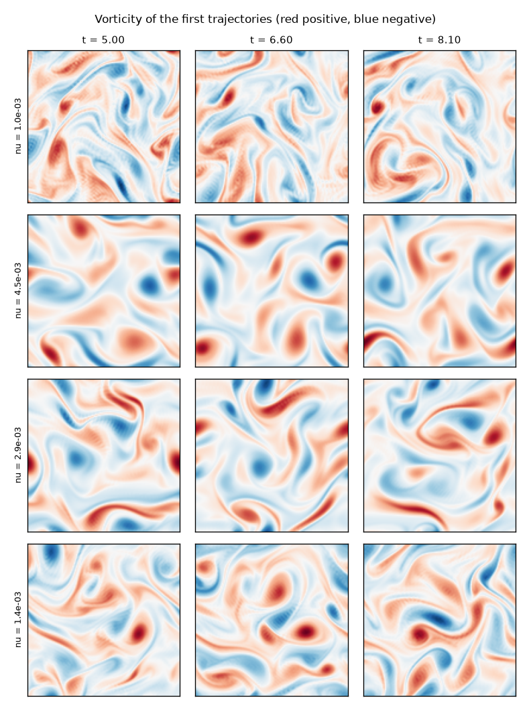

# Dataset card: flow `48cfb975f833`

Generated by `dvc repro` (dvc.yaml); this card is rewritten with every dataset version.

## Contents

- 1024 trajectories of 2D incompressible flow, 32 frames each, 128 x 128 grid, float32 vorticity (2147 MB)
- Equation: d omega/dt + u . grad omega = nu lap omega - alpha omega - A k_f cos(k_f y), u = (psi_y, -psi_x), lap psi = -omega
- Domain: [0, 2 pi)^2, periodic; x along the last axis, y along the second to last
- Forcing A = 1.0, k_f = 4; drag alpha = 0.1
- Viscosity log-uniform in [0.001, 0.005], one per trajectory
- Initial vorticity: Gaussian random field, spectrum (|k|^2 + 7^2)^(-2.5/2), RMS 5
- Frames every 40 steps of dt = 0.0025 (every 0.1 time units) after 2000 spin-up steps; t = 5 to 8.1

## Provenance

- Config hash: `48cfb975f8338298a9ced0ef20d263c51adb1593e3ae065666a1fb6d7bf8575a`
- Code: git commit `8d53c13a77bfe199ea6a7b8d6c21a5c9d011f167`
- Created: 2026-11-06T22:43:28+00:00
- Solver: gpu backend, FFT `stockham_r8`, pruned = True; IMEX Crank-Nicolson / Heun, 2/3-rule dealiasing
- Seeds: sample i uses SeedSequence([0, i]) (flow.generate.sample_seed)

## Statistics

| | min | mean | max |
|---|---:|---:|---:|
| energy, first frame | 0.6038 | 0.9279 | 1.619 |
| energy, last frame | 0.4916 | 0.8705 | 1.452 |
| max abs vorticity | 10.8 | 16.64 | 23.34 |
| max CFL number | 0.121 | 0.187 | 0.297 |
| viscosity | 0.001 | 0.00245 | 0.005 |

Viscosity histogram (10 bins in log10): 106 93 105 113 113 99 107 86 109 93

## Validation

**Passed** (spectral.flow.validate; thresholds in params.yaml):

- passed: complete
- passed: finite
- passed: bounded
- passed: cfl
- passed: energy
- passed: resolved
- passed: parameters
- passed: provenance

## Intended use

Training and evaluating neural operators that map vorticity at one time to later times (Phase 3), read through the streaming loader of Task 2.7. The flows are 2D, periodic, and forced at one wavenumber: not a model of any particular physical system.
